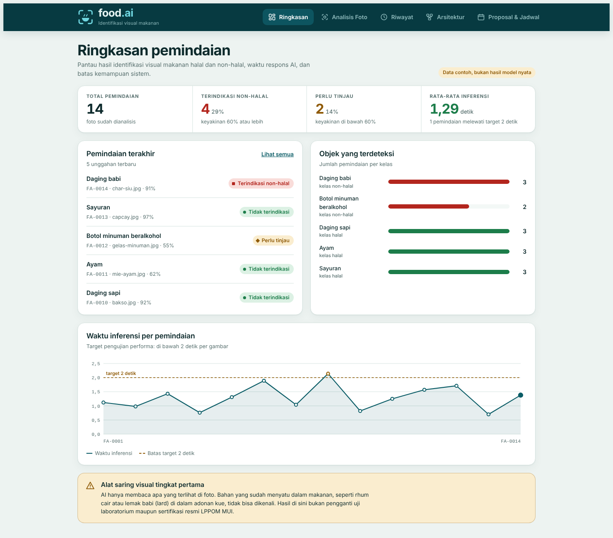
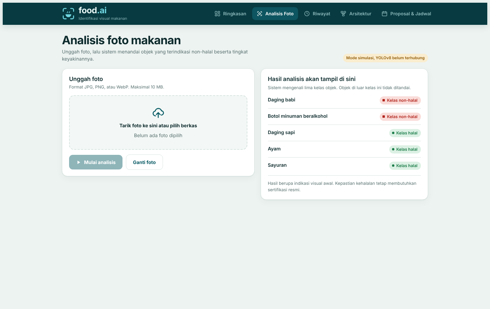
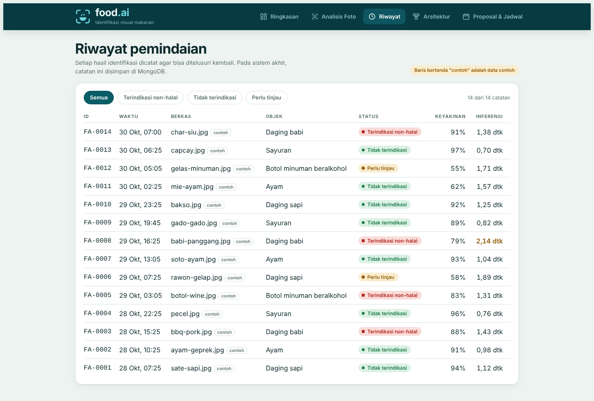
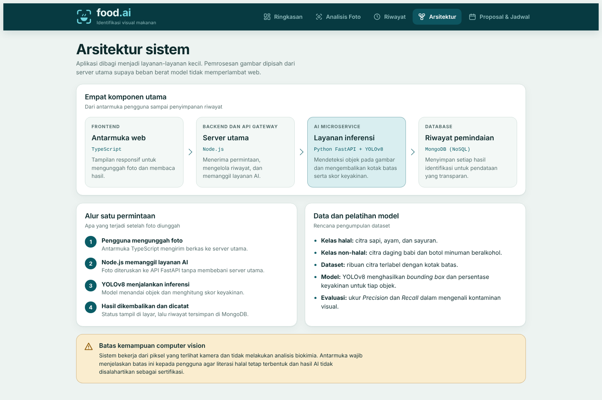
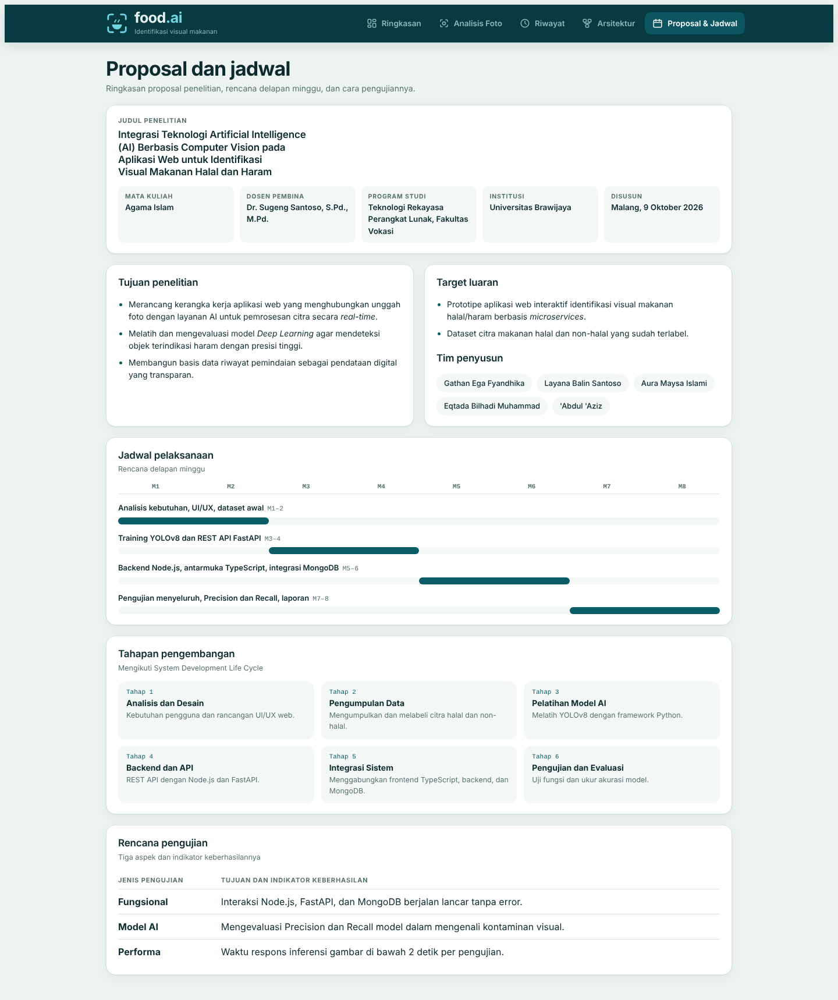
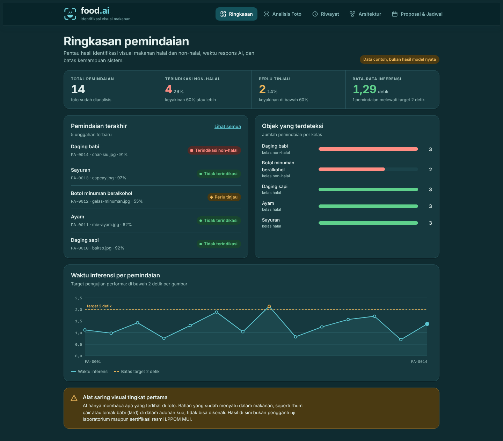
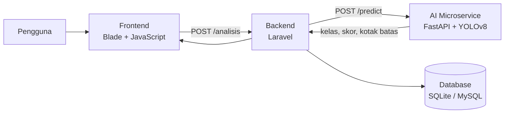

# food.ai

Dashboard web untuk **identifikasi visual makanan halal dan haram** berbasis AI *computer vision*.
Pengguna mengunggah foto makanan, lalu sistem menandai objek yang terindikasi non-halal beserta skor keyakinannya.
Seluruh hasil dicatat di riwayat pemindaian agar bisa ditelusuri kembali.

Proyek ini disusun untuk tugas mata kuliah **Agama Islam**, Program Studi Teknologi Rekayasa Perangkat Lunak,
Fakultas Vokasi, Universitas Brawijaya, berdasarkan proposal
*"Integrasi Teknologi Artificial Intelligence (AI) Berbasis Computer Vision pada Aplikasi Web untuk Identifikasi Visual Makanan Halal dan Haram"*.

> **Batas sistem.** food.ai adalah alat saring visual tingkat pertama. AI hanya membaca apa yang terlihat di foto
> dan tidak dapat mendeteksi bahan yang sudah menyatu dalam makanan, misalnya rhum cair atau lemak babi (*lard*) dalam adonan kue.
> Hasilnya bukan pengganti uji laboratorium maupun sertifikasi resmi LPPOM MUI.

## Tangkapan layar

| Ringkasan | Analisis Foto |
| --- | --- |
|  |  |

| Riwayat Pemindaian | Arsitektur Sistem |
| --- | --- |
|  |  |

| Proposal dan Jadwal | Mode gelap |
| --- | --- |
|  |  |

## Fitur

- **Ringkasan:** total pemindaian, jumlah terindikasi non-halal dan perlu tinjau, rata-rata waktu inferensi, sebaran objek per kelas, dan grafik waktu inferensi terhadap target 2 detik.
- **Analisis Foto:** unggah foto (JPG, PNG, WebP, maksimal 10 MB) dengan tarik-lepas, pratinjau, kotak batas (*bounding box*), status, dan skor keyakinan.
- **Riwayat Pemindaian:** tabel semua hasil dengan filter status. Setiap analisis tersimpan di database.
- **Arsitektur Sistem:** diagram komponen dan alur satu permintaan.
- **Proposal dan Jadwal:** ringkasan proposal, jadwal delapan minggu, tahapan SDLC, dan rencana pengujian.
- Navbar responsif, tampilan terang dan gelap mengikuti pengaturan perangkat.

### Status hasil

| Status | Aturan |
| --- | --- |
| Terindikasi non-halal | Kelas non-halal (babi, minuman beralkohol) dengan keyakinan 60% atau lebih |
| Tidak terindikasi | Kelas halal (sapi, ayam, sayuran) dengan keyakinan 60% atau lebih |
| Perlu tinjau | Keyakinan di bawah 60% |

Label "Tidak terindikasi" sengaja dipakai, bukan "Halal", karena penilaian visual tidak bisa membuktikan kehalalan.

## Arsitektur



Pemrosesan gambar dipisahkan ke layanan Python sendiri supaya beban model *deep learning* tidak memperlambat server web utama.

| Komponen | Teknologi | Fungsi |
| --- | --- | --- |
| Frontend | Blade, JavaScript, CSS | Antarmuka unggah foto dan dashboard |
| Backend dan API Gateway | Laravel 11/12 (PHP 8.2+) | Validasi unggahan, memanggil layanan AI, menyimpan riwayat |
| AI Microservice | Python FastAPI, YOLOv8 | Inferensi gambar |
| Database | SQLite atau MySQL (Eloquent) | Riwayat pemindaian |

> Proposal awal merencanakan Node.js dan MongoDB untuk backend. Repositori ini memakai Laravel dan Eloquent sebagai gantinya.

## Struktur proyek

```
.
├── app/
│   ├── Http/Controllers/
│   │   ├── DashboardController.php   # data tiap halaman
│   │   └── ScanController.php        # validasi foto, panggil FastAPI, simpan riwayat
│   └── Models/Scan.php               # kelas, status, ambang keyakinan
├── config/foodai.php                 # FASTAPI_URL, ambang 0,6, target 2000 ms
├── database/
│   ├── migrations/                   # tabel scans
│   └── seeders/ScanSeeder.php        # data contoh
├── docs/screenshots/                 # gambar untuk README
├── fastapi_service/main.py           # contoh layanan inferensi YOLOv8
├── public/
│   ├── css/foodai.css
│   └── js/foodai.js                  # grafik dan unggah foto
├── resources/views/                  # layout navbar + 5 halaman Blade
└── routes/web.php
```

Folder ini berisi file tambahan untuk proyek Laravel baru. Kerangka Laravel (`artisan`, `composer.json`, dan seterusnya) dibuat oleh Composer pada langkah instalasi.

## Instalasi

Prasyarat: PHP 8.2 atau lebih baru, Composer, dan (opsional untuk model AI) Python 3.10 atau lebih baru.

```bash
# 1. Buat proyek Laravel, lalu salin isi repositori ini ke dalamnya (timpa routes/web.php)
composer create-project laravel/laravel foodai
cd foodai
git clone https://github.com/<username>/food-ai.git ../food-ai
cp -r ../food-ai/{app,config,database,docs,fastapi_service,public,resources,routes} .

# 2. Atur .env
#    APP_LOCALE=id
#    APP_FALLBACK_LOCALE=id
#    FASTAPI_URL=            (kosong = mode simulasi)

# 3. Migrasi database dan data contoh (opsional)
php artisan migrate
php artisan db:seed --class=ScanSeeder

# 4. Jalankan
php artisan serve
```

Buka http://127.0.0.1:8000.

## Menghubungkan model AI

1. Latih YOLOv8 dengan nama kelas `babi`, `alkohol`, `sapi`, `ayam`, `sayur`.
2. Taruh bobot di `fastapi_service/weights/best.pt`, lalu jalankan layanan:

   ```bash
   cd fastapi_service
   pip install fastapi uvicorn python-multipart ultralytics pillow
   uvicorn main:app --port 8001
   ```

3. Isi `FASTAPI_URL=http://127.0.0.1:8001` di `.env`, lalu jalankan `php artisan config:clear`.

### Kontrak API layanan AI

`POST /predict` (multipart, field `file`)

```json
{
  "kelas": "babi",
  "conf": 0.91,
  "box": { "x": 12, "y": 18, "w": 40, "h": 35 }
}
```

`box` dalam persen terhadap lebar dan tinggi gambar. Status `404` berarti tidak ada objek yang dikenali.

## Mode simulasi

Selama `FASTAPI_URL` kosong, aplikasi tetap bisa dicoba. Kelas dan skor dipilih dari nama dan ukuran berkas, **bukan dari isi gambar**,
dan halaman Analisis Foto menampilkan label "Mode simulasi". Baris dari seeder ditandai "contoh" di riwayat.
Foto yang diunggah tidak disimpan; hanya hasil deteksinya yang dicatat.

## Status proyek

- Tampilan dan alur dashboard sudah berjalan sebagai prototipe.
- File PHP, JavaScript, dan Python sudah lolos pengecekan sintaks. Template Blade dan alur unggah belum diuji end-to-end pada instalasi Laravel nyata.
- Model YOLOv8 belum dilatih dan belum terhubung.

## Rencana pelaksanaan

Rencana delapan minggu dari proposal:

- [ ] **Minggu 1–2:** analisis kebutuhan, perancangan UI/UX, pengumpulan dataset awal
- [ ] **Minggu 3–4:** pelatihan YOLOv8 dan pembuatan REST API FastAPI
- [ ] **Minggu 5–6:** pengembangan backend, antarmuka, dan integrasi database
- [ ] **Minggu 7–8:** pengujian menyeluruh (Precision, Recall), finalisasi laporan

Indikator keberhasilan: interaksi Laravel, FastAPI, dan database berjalan tanpa error; Precision dan Recall model dievaluasi;
waktu inferensi di bawah 2 detik per gambar.

## Tim penyusun

- Gathan Ega Fyandhika
- Layana Balin Santoso
- Aura Maysa Islami
- Eqtada Bilhadi Muhammad
- 'Abdul 'Aziz

Dosen pembina: Dr. Sugeng Santoso, S.Pd., M.Pd.
Universitas Brawijaya, Fakultas Vokasi, Program Studi Teknologi Rekayasa Perangkat Lunak. Malang, Oktober 2026.
